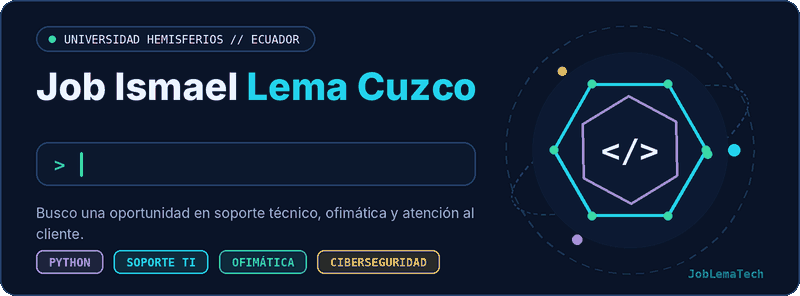
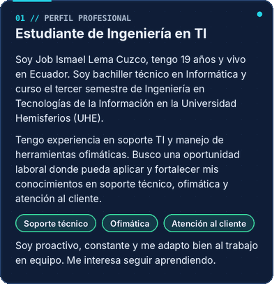
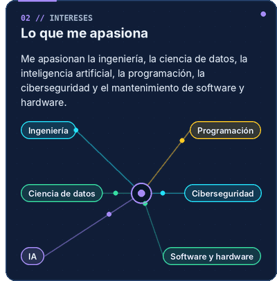
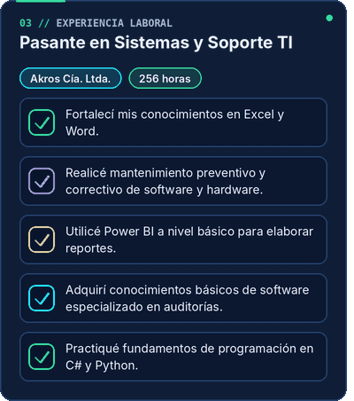
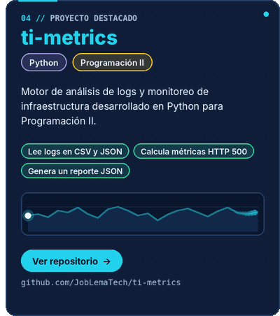
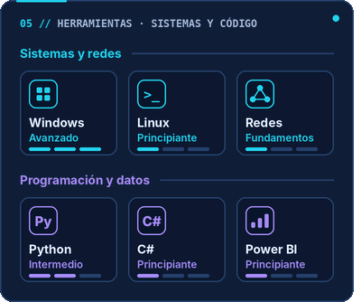
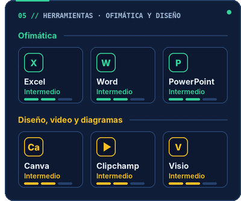
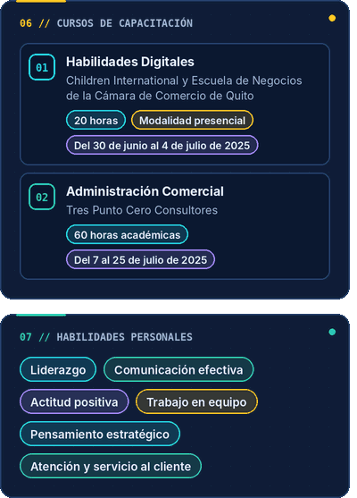
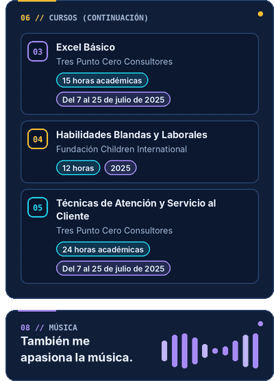

<b>Leer el perfil en texto</b>

## Job Ismael Lema Cuzco

Ecuador · Universidad Hemisferios (UHE) · Estudiante de Ingeniería en TI · Soporte técnico y ofimática · Interés en ciencia de datos e IA · Interés en ciberseguridad

### Perfil profesional

Soy Job Ismael Lema Cuzco, tengo 19 años y vivo en Ecuador. Soy bachiller técnico en Informática y curso el tercer semestre de Ingeniería en Tecnologías de la Información en la Universidad Hemisferios (UHE).

Tengo experiencia en soporte TI y manejo de herramientas ofimáticas. Busco una oportunidad laboral donde pueda aplicar y fortalecer mis conocimientos en soporte técnico, ofimática y atención al cliente.

Soy proactivo, constante y me adapto bien al trabajo en equipo. Me interesa seguir aprendiendo.

Me apasionan la ingeniería, la ciencia de datos, la inteligencia artificial, la programación, la ciberseguridad y el mantenimiento de software y hardware.

### Experiencia laboral

**Pasante en Sistemas y Soporte TI** · Akros Cía. Ltda. · 256 horas

- Fortalecí mis conocimientos en Excel y Word.
- Realicé mantenimiento preventivo y correctivo de software y hardware.
- Utilicé Power BI a nivel básico para elaborar reportes.
- Adquirí conocimientos básicos de software especializado en auditorías.
- Practiqué fundamentos de programación en C# y Python.

### Proyecto destacado

**[ti-metrics](https://github.com/JobLemaTech/ti-metrics)**: motor de análisis de logs y monitoreo de infraestructura desarrollado en Python para Programación II. Según el README del repositorio, lee logs en CSV y JSON, calcula métricas de errores HTTP 500 y genera un reporte JSON.

### Herramientas y habilidades

| Área | Herramienta | Nivel |
| --- | --- | --- |
| Sistemas y redes | Windows | Avanzado |
| Sistemas y redes | Linux | Principiante |
| Sistemas y redes | Redes | Fundamentos |
| Programación y datos | Python | Intermedio |
| Programación y datos | C# | Principiante |
| Programación y datos | Power BI | Principiante |
| Ofimática | Excel | Intermedio |
| Ofimática | Word | Intermedio |
| Ofimática | PowerPoint | Intermedio |
| Diseño, video y diagramas | Canva | Intermedio |
| Diseño, video y diagramas | Clipchamp | Intermedio |
| Diseño, video y diagramas | Visio | Intermedio |

**Habilidades personales:** liderazgo, comunicación efectiva, actitud positiva, trabajo en equipo, pensamiento estratégico y atención y servicio al cliente.

### Cursos de capacitación

1. **Habilidades Digitales** · 20 horas · Children International y Escuela de Negocios de la Cámara de Comercio de Quito · del 30 de junio al 4 de julio de 2025 · modalidad presencial.
2. **Administración Comercial** · 60 horas académicas · Tres Punto Cero Consultores · del 7 al 25 de julio de 2025.
3. **Excel Básico** · 15 horas académicas · Tres Punto Cero Consultores · del 7 al 25 de julio de 2025.
4. **Habilidades Blandas y Laborales** · 12 horas · Fundación Children International · 2025.
5. **Técnicas de Atención y Servicio al Cliente** · 24 horas académicas · Tres Punto Cero Consultores · del 7 al 25 de julio de 2025.

### Contacto y redes

- Instagram: [@jobbb_lema](https://www.instagram.com/jobbb_lema/)
- LinkedIn: [linkedin.com/in/job-lema-9896b635b](https://www.linkedin.com/in/job-lema-9896b635b/)
- Correo: [joblema3008@gmail.com](mailto:joblema3008@gmail.com)

### También

Me apasiona la música.

